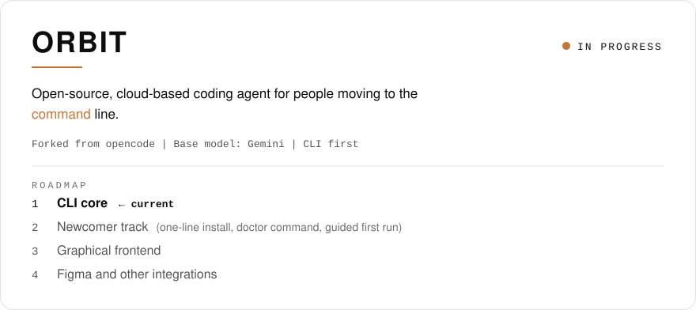
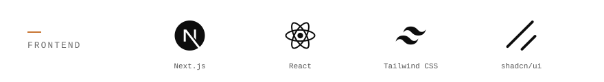
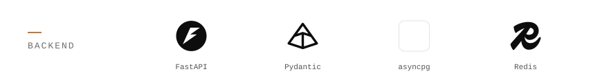
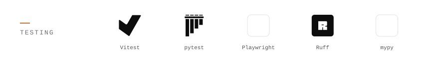

<picture>
  <source media="(prefers-color-scheme: dark)" srcset="assets/header-dark.svg">
  
</picture>

Software Engineering student at Obafemi Awolowo University, building toward AI engineering.
I build developer tools, and the web apps that grow around them.

---

### ORBIT

<a href="https://github.com/CalebPiusC/ORBIT">
  <picture>
    <source media="(prefers-color-scheme: dark)" srcset="assets/orbit-card-dark.svg">
    
  </picture>
</a>

### Selvora

AI sales assistant for Nigerian vendors — Next.js 16, FastAPI, Supabase/Postgres with row-level security.
Status: `active` · [github.com/CalebPiusC/selvora](https://github.com/CalebPiusC/selvora)

---

### Tech stack

<picture>
  <source media="(prefers-color-scheme: dark)" srcset="assets/stack-languages-dark.svg">
  
</picture>

<picture>
  <source media="(prefers-color-scheme: dark)" srcset="assets/stack-frontend-dark.svg">
  
</picture>

<picture>
  <source media="(prefers-color-scheme: dark)" srcset="assets/stack-backend-dark.svg">
  
</picture>

<picture>
  <source media="(prefers-color-scheme: dark)" srcset="assets/stack-data-dark.svg">
  
</picture>

<picture>
  <source media="(prefers-color-scheme: dark)" srcset="assets/stack-testing-dark.svg">
  
</picture>

<picture>
  <source media="(prefers-color-scheme: dark)" srcset="assets/stack-devops-dark.svg">
  
</picture>

---

### Projects

| Project | What it is | Stack |
| :--- | :--- | :--- |
| [Selvora](https://github.com/CalebPiusC/selvora) | AI sales assistant for vendors (active) | Next.js, FastAPI, Postgres, Redis |
| [RepoLens](https://github.com/CalebPiusC/RepoLens) | Repository health checker CLI for Python and JS/TS | Python, Pydantic, Ruff, Bandit, Biome |
| [UniEvents](https://github.com/CalebPiusC/UniEvents) | University events platform (coursework) | HTML/CSS/JS, Firebase |
| [SciCalc](https://github.com/CalebPiusC/SciCalc) | Android scientific calculator | Kotlin |

---

`X` [@YOUR_X_HANDLE](https://x.com/YOUR_X_HANDLE) &nbsp;·&nbsp; `LinkedIn` [YOUR_LINKEDIN](https://www.linkedin.com/in/YOUR_LINKEDIN) &nbsp;·&nbsp; `Email` [YOUR_EMAIL](mailto:YOUR_EMAIL)

<!--
Maintainer notes (not rendered):
- Placeholders to replace: YOUR_X_HANDLE, YOUR_LINKEDIN, YOUR_EMAIL.
- ORBIT is described as a fork of opencode. Update the card's meta line and
  roadmap step 1 only once there are real commits in CalebPiusC/ORBIT.
- All images are generated by scripts/build-assets.py. Change ACCENT there and
  re-run `python3 scripts/build-assets.py` to recolor every SVG.
-->
